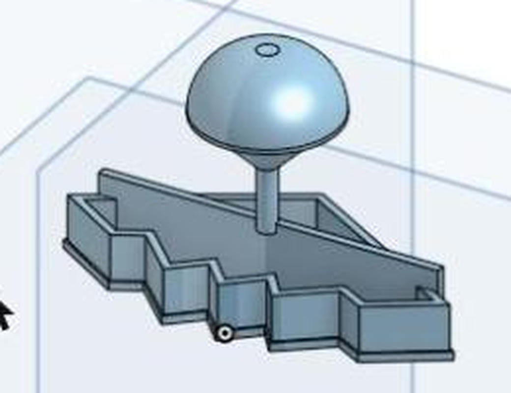

# B-2 Bomber Cookie Cutter

A B-2 stealth bomber cookie cutter for the Hack Club BakeBuild mission, designed in Onshape.

- Stick handle with a dome on top, easy to hold
- Built-in print supports (45° cone under the dome and a support web under the bar) so the handle doesn't break
- Wall 2 mm, cutting depth 12.7 mm, about 82 mm wide

Model: `b2-bomber-cookie-cutter.step`

